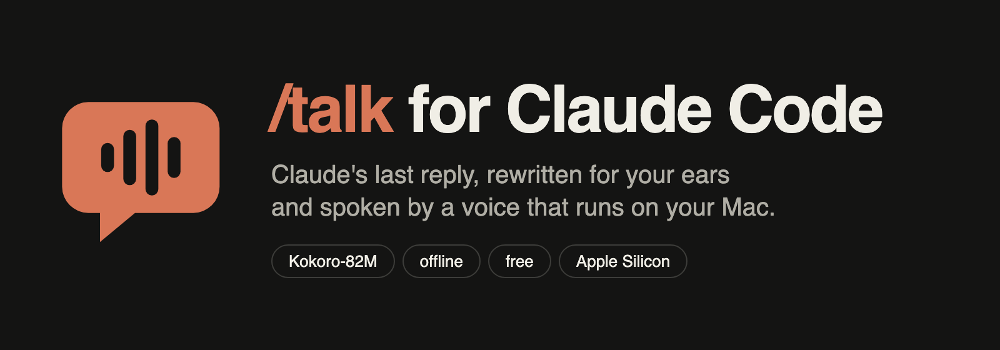

# /talk for Claude Code

**Type `/talk` and Claude reads its last reply out loud: rewritten for the ear, spoken by a voice model that runs on your Mac.**

| Measured on an M3 Pro MacBook Pro | Result |
| --- | --- |
| 59-word reply → speech | 19.9 s of audio generated in **4.9 s**, cold start included |
| Time until you hear it | about 4 s (speech streams sentence by sentence) |
| Network needed after setup | **none** (checked with every connection blocked) |
| Cost | free, no API key |
| Disk | about 530 MB engine + 370 MB model |

One machine, one run per check. Re-run them yourself with `npm run check`.

## Install

Paste this in your terminal:

```bash
claude plugin marketplace add goodrahstar/talk-for-claude && claude plugin install talk@talk-for-claude
```

Or inside Claude Code:

```
/plugin marketplace add goodrahstar/talk-for-claude
/plugin install talk@talk-for-claude
```

The first `/talk` sets up the voice once (a few minutes). It needs an **Apple Silicon Mac** and **uv** (`brew install uv`).

## Use

| Type | What happens |
| --- | --- |
| `/talk` | Claude rewrites its last reply for listening and speaks it |
| `/talk short` | A shorter spoken version |
| `/talk just the steps` | Any focus you want |
| `/talk stop` | Stops speaking |

Change the voice with `TALK_VOICE` (default `af_heart`; try `am_michael`, `bf_emma`) and the pace with `TALK_SPEED` (default `1.05`).

## How it works

1. **Rewrite.** Claude turns its reply into speech: main point first, no symbols, no file paths read letter by letter, lists said as "first, then, last", 40 to 200 words.
2. **Clean.** A safety pass strips any leftover markdown, code, links and emoji.
3. **Speak.** [Kokoro-82M](https://huggingface.co/hexgrad/Kokoro-82M) runs locally on Apple's MLX via [mlx-audio](https://github.com/Blaizzy/mlx-audio). Audio plays sentence by sentence while the rest is still being generated. The command returns at once, so you keep working.

Why Kokoro-82M: it is the smallest of the open voice models I tested (Pocket TTS 100M, LuxTTS, Orpheus 3B) and still sounds natural.

## Files

| File | Job |
| --- | --- |
| `skills/talk/SKILL.md` | The `/talk` command: the rewrite-for-listening rules Claude follows |
| `bin/talk` | The CLI Claude calls; also usable from any terminal |
| `engine/talk.py` | Cleaning, Kokoro synthesis, background playback, stop |
| `scripts/setup.sh` | One-time setup into `~/.claude-talk` |
| `checks/` | The gate checks behind every number above |

## Limits

- macOS on Apple Silicon only (MLX and `afplay`).
- English voices only in this version.
- Each `/talk` loads the model fresh (about 0.5 s) and frees the memory afterwards.
- Numbers come from one M3 Pro. Older M1 chips will be slower.

## Uninstall

```bash
claude plugin uninstall talk@talk-for-claude && rm -rf ~/.claude-talk
```

## Checks

`npm run check` re-runs every gate in [GATES.md](GATES.md):

| Gate | Proves |
| --- | --- |
| P1 | Claude Code's validator accepts the plugin and marketplace |
| P2 | Real speech, offline, under 10 s for 60 words, background play and stop, markdown cleaning |
| P3 | No keys or personal paths in the repo (detectors proven on planted samples) |
| P4 | Fresh install from this GitHub repo into an empty Claude config sets itself up and speaks |
| P5 | Public repo, MIT license, release zip that validates as a plugin |
| P6 | The install line above matches the names that actually installed |

## License

MIT. Kokoro-82M is Apache-2.0.
